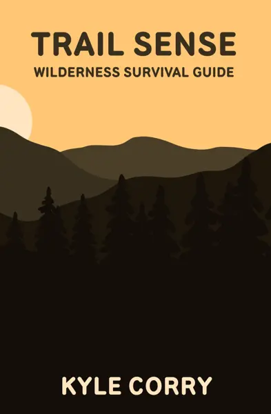
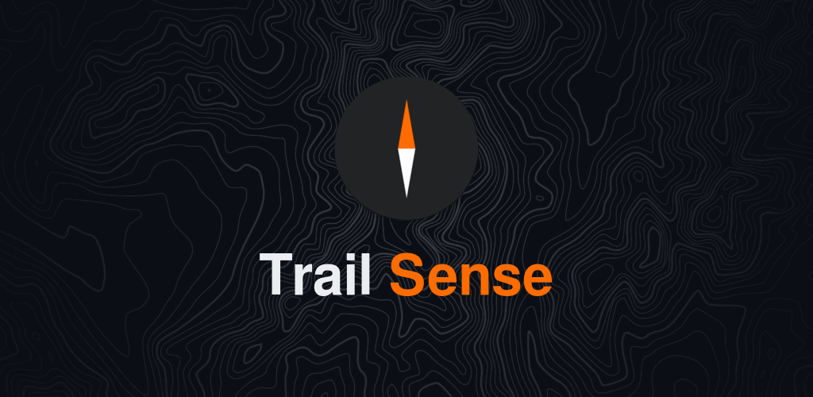
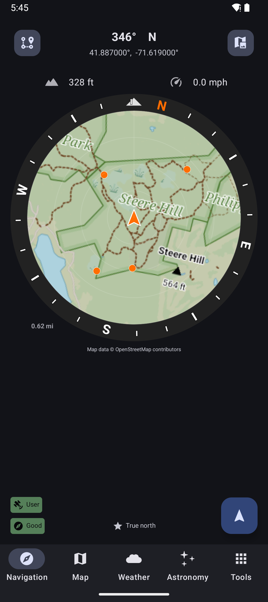
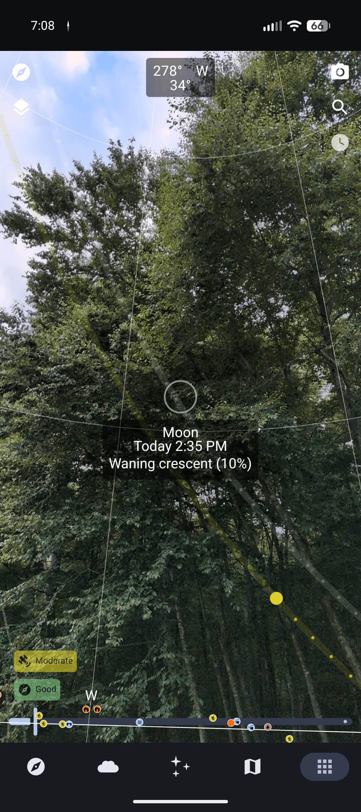
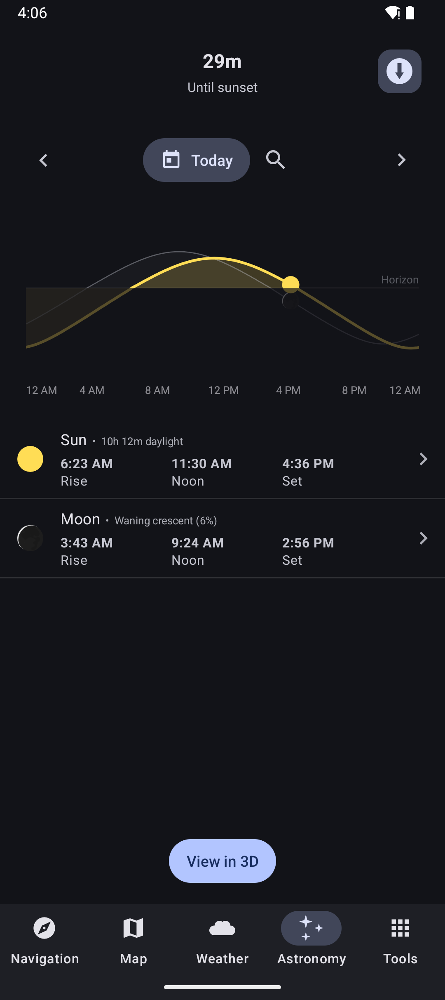
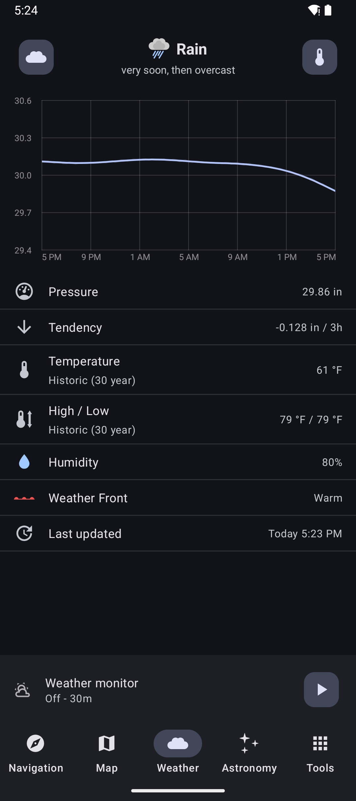
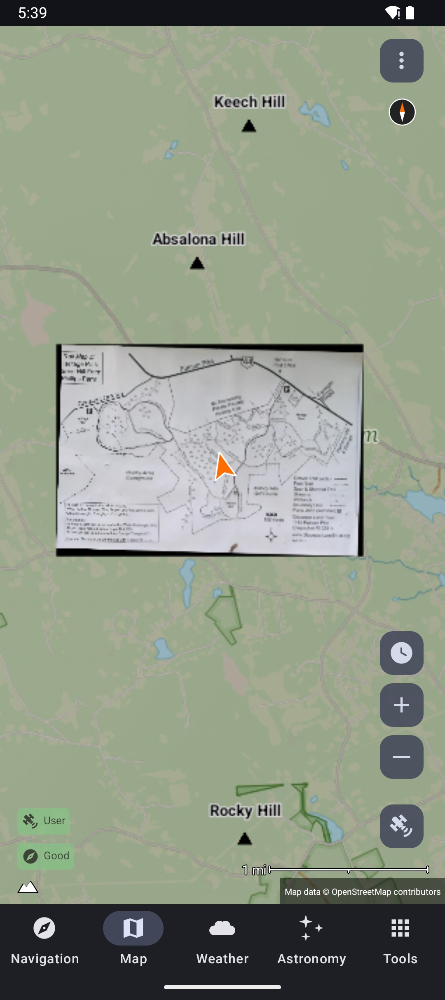
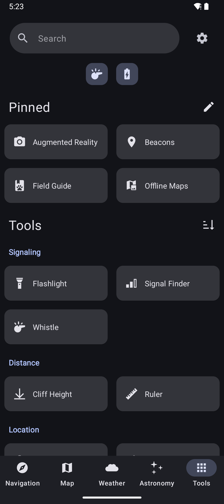

# Trail Sense

Trail Sense is an offline multi-tool Android app for hiking, backpacking, camping, wilderness survival, foraging, and hunting.

> [!IMPORTANT]
> Trail Sense is a tool, and like any other tool you bring into the wilderness, it's essential to have backup equipment and the skills to stay safe without it. Never rely on it alone.

<table>
    <tr>
        <th>F-Droid</th>
        <th>Google Play</th>
        <th>Obtainium</th>
        <th>Survival Guide</th>
    </tr>
    <tr>
        <td>
            
        </td>
        <td>
            
        </td>
        <td>
          <a href="https://apps.obtainium.imranr.dev/redirect?r=obtainium://app/{%22id%22:%22com.kylecorry.trail_sense%22,%22url%22:%22https://github.com/kylecorry31/Trail-Sense%22,%22author%22:%22kylecorry31%22,%22name%22:%22Trail%20Sense%22,%22additionalSettings%22:%22{\%22apkFilterRegEx\%22:\%22\\\\d-release\%22,\%22invertAPKFilter\%22:false,\%22about\%22:\%22Use%20your%20Android%20phone%27s%20sensors%20to%20assist%20with%20wilderness%20treks%20or%20survival%20situations.%20Designed%20for%20entirely%20offline%20use.\%22}%22}">
            
          </a>
        </td>
        <td align="center">
            
        </td>
    </tr>
</table>

## Features

- Navigate using beacons (waypoints), paths, and bearings
- Retrace your steps with backtrack
- Use a photo as a map
- View offline maps
- Plan what to pack
- Be alerted before the sun sets
- Predict the weather and tides
- Use your phone as a flashlight
- [And much more!](https://github.com/kylecorry31/Trail-Sense/wiki/Use-Cases)

See the [project board](https://github.com/users/kylecorry31/projects/2) for the current priority order of planned features. There are no associated release dates. Since Trail Sense is a hobby project that I also use daily, priorities may change as my interests and needs evolve.

See the need for a new feature? [Post it here!](https://github.com/kylecorry31/Trail-Sense/discussions/new/choose)

<table>
  <tr>
    <td>
      
    </td>
    <td>
      
    </td>
    <td>
      
    </td>
  </tr>
  <tr>
    <td>
      
    </td>
    <td>
      
    </td>
    <td>
      
    </td>
  </tr>
</table>

## Documentation

See the [User Guide](https://kylecorry.com/Trail-Sense/user-guide/) for a guide on how to use Trail Sense. This is also available in the app, just search on the Tools tab for User Guide.

See the [Technical Blog / Research](https://kylecorry.com/research/categories/trail-sense/) for technical details about how I implemented a few of the features.

## Privacy

Trail Sense does not require an Internet connection. All app data, including location history, is stored in the app's private local storage, which is inaccessible to other apps. This data is cleared when you clear Trail Sense's app storage or uninstall it. See the [privacy policy](https://kylecorry.com/Trail-Sense/privacy_policy.html) for details about data and permissions.

## Contributing
See the [CONTRIBUTING.md](https://github.com/kylecorry31/Trail-Sense/blob/main/CONTRIBUTING.md) file for details on contributing to Trail Sense.

## Copying
You are allowed to create copies of Trail Sense and rebrand to what you see fit. The app code is under the MIT license. The Survival Guide content is under its own license, so check the [Survival Guide License](SURVIVAL_GUIDE_LICENSE.md) before reusing it.

Please change the following if you are using this as the base for your app:
- App name
- Package name
- Support email
- App icon (optional)

## FAQ
The FAQ can be found [on the website](https://kylecorry.com/Trail-Sense/faq.html)

## Open Source Credits

- Thank you to everyone who tried out this app and opened issues, suggested features, provided translations, or tested debug builds for me
- Please see the in app licenses for all open source licenses
- Contributors and translators: https://github.com/kylecorry31/Trail-Sense/graphs/contributors

## License

- **[MIT license](LICENSE)**
- **[Survival Guide License](SURVIVAL_GUIDE_LICENSE.md)**
